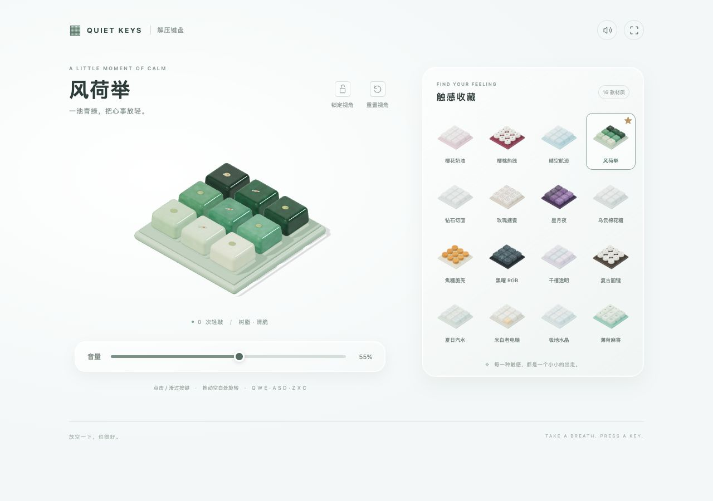

# Quiet Keys · 电子解压键盘

[打开网页版（私有预览）](https://quiet-keys-studio.carlgustav.chatgpt.site)

[](https://quiet-keys-studio.carlgustav.chatgpt.site)

根据参考视频复刻的可交互网页版：九宫格立体键盘、16 款材质、独立按键回弹，以及不同材质的敲击声音。

## 本地运行

```bash
python3 -m http.server 4173 --directory dist
```

打开 http://localhost:4173 。无需安装或构建，模型、材质、声音都在浏览器本地生成，Three.js 已随项目提供。

## 操作

- **鼠标 / 触屏**：按住键帽，或连续滑过多个按键。
- **实体键盘**：`Q W E / A S D / Z X C`、数字 `1–9`，或数字小键盘。
- **旋转**：拖动键盘外的空白处；在键帽上可用右键、Shift + 拖动，触屏可用双指。
- **视角**：锁定 / 解锁、重置。支持全屏（取决于浏览器）。
- **材质**：16 款可直接切换，星标收藏、上次选择及音量保存在当前浏览器。
- **声音**：首次按键后启用，支持音量调节和静音。

## 复刻范围

保留参考中的九宫格造型、白色界面、16 款皮肤名称、材质选择、视角控制和音量滑杆；桌面使用双栏布局，手机使用上下布局。3D 模型、程序纹理和 Web Audio 音效为本项目重新制作，未使用原游戏源代码或原始模型、录音。

核心文件：`dist/index.html`、`dist/style.css`、`dist/app.js`。`dist/vendor/` 包含 MIT 许可的 Three.js 0.180.0。
